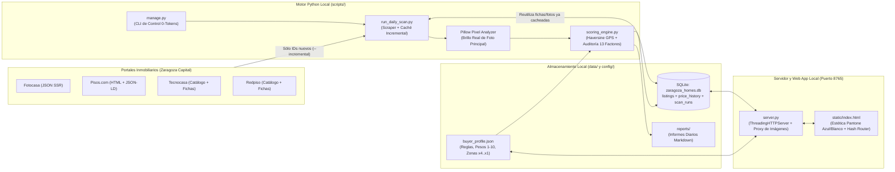

# Zaragoza Vivienda (ZGZ House Finder) — Documento Técnico, Arquitectura y Manual de Operación

> **Documento Vivo (v2.1)** — Este manual explica la construcción técnica de la plataforma local **ZGZ House Finder**, las tecnologías empleadas, el funcionamiento interno del motor de extracción y auditoría matemática, cómo operarlo consumiendo **0 tokens de IA** y qué significa cada dato calculado y visualizado en la interfaz web.
>
> **Ubicación del repositorio**: `C:\personal\Git_Repositories\zgz-house-finder`

---

## 1. Arquitectura General y Tecnologías Empleadas

La plataforma sigue una arquitectura **Local-First, Cero Dependencias Frágiles y Cero Gasto de Tokens en Producción**, pensada para ejecutarse en Windows de forma autónoma y mantenible a largo plazo.



### Stack Tecnológico

| Capa | Tecnología | Archivo Principal | Justificación Técnica |
| :--- | :--- | :--- | :--- |
| **Base de Datos** | **SQLite 3** | [`data/zaragoza_homes.db`](../data/zaragoza_homes.db) | Base de datos relacional transaccional en un único archivo local. Almacena los pisos (`listings`), su JSON original (`raw_json`), su desglose de puntuación (`score_json`), historial de precios (`price_history`) y tus notas/estados personales (`user_status`, `user_notes`). |
| **Servidor Backend y API** | **Python 3 Standard Library** (`ThreadingHTTPServer`, `sqlite3`, `urllib`) | [`server.py`](../server.py) | Servidor HTTP multihilo nativo sin dependencias de Node.js ni frameworks externos. Incluye un endpoint `/api/image-proxy` con caché para evitar bloqueos de hotlinking en fotos de portales. |
| **Motor de Puntuación y Finanzas** | **Python 3 (`math`, `re`, `json`)** | [`scripts/scoring_engine.py`](../scripts/scoring_engine.py) | Motor determinista y auditable: calcula distancias geodésicas GPS (fórmula de Haversine), costes de reforma por partida, hipoteca e ITP en Aragón, y los 13 factores con su evidencia exacta. |
| **Scraper Multi-Portal e Imagen** | **Python 3 + Pillow (`PIL`)** | [`scripts/run_daily_scan.py`](../scripts/run_daily_scan.py) | Extrae anuncios reales de Fotocasa, Pisos.com, Tecnocasa y Redpiso con **caché incremental** en SQLite y mide la luminosidad real (`0-255`) de los píxeles de la foto principal sin gastar tokens de visión IA. |
| **Frontend Web (SPA)** | **HTML5 + CSS3 + Vanilla JS (ES6+)** | [`static/index.html`](../static/index.html) | Interfaz editorial limpia sin elementos estridentes ni emojis, basada en una paleta **Pantone Azul Calmado (`#2B5B84`), Blancos Arquitectónicos (`#FFFFFF` / `#F4F7FA`) y Gris Pizarra (`#1E293B`)**, con vista principal (`#/`) y página interna por vivienda (`#/piso/<id>`). |
| **Cartografía Interactiva** | **Leaflet.js + OpenStreetMap** | [`static/index.html`](../static/index.html) | Mapa interactivo de uso libre (`tile.openstreetmap.org`, sin API keys de pago) con estado activo en el botón superior, barra de cierre directo y marcadores codificados por color según puntuación y tipo de vendedor. |

---

## 2. Estructura de Directorios en `C:\personal\Git_Repositories\zgz-house-finder`

```text
C:\personal\Git_Repositories\zgz-house-finder\
├── config/
│   └── buyer_profile.json                # Perfil financiero, pesos (1-10), bonos y clasificación de barrios (x4..x1)
├── data/
│   ├── zaragoza_homes.db                 # Base de datos SQLite con los 272+ inmuebles reales e histórico
│   ├── ultimo_informe_diario.md          # Último resumen ejecutivo (ligero para consulta rápida)
│   └── reports/
│       └── report_YYYY-MM-DD.md          # Histórico de informes diarios generados automáticamente
├── docs/
│   ├── ARQUITECTURA_Y_MANUAL_TECNICO.md  # Este documento técnico y funcional (documento vivo)
│   └── GUIA_COMPRA_ZARAGOZA.md           # Guía práctica de compra de vivienda en Zaragoza e impuestos en Aragón
├── scripts/
│   ├── scoring_engine.py                 # Motor matemático: auditoría de 13 factores, Haversine GPS y finanzas
│   ├── run_daily_scan.py                 # Scraper multi-portal con caché incremental (--incremental, --recalc-only)
│   └── manage.py                         # Herramienta CLI para operar todo el sistema con 0 tokens
├── static/
│   └── index.html                        # Aplicación Web (Catálogo Principal + Página Detalle #/piso/<id>)
├── server.py                             # Servidor Web Local y API REST (http://127.0.0.1:8765)
├── iniciar_web.bat                       # Lanzador de 1 clic para encender la web local en Windows
└── rastreo_silencioso_sin_tokens.bat     # Lanzador silencioso del rastreo diario incremental (0 tokens IA)
```

---

## 3. Funcionamiento Interno del Pipeline de Datos

### 3.1. Extracción Multi-Portal con Caché Incremental (`scripts/run_daily_scan.py`)
El recolector consulta **4 portales inmobiliarios** en Zaragoza capital:
1. **Fotocasa**: Extrae el estado JSON (`window.__INITIAL_PROPS__`) con precio, m², habitaciones, planta, coordenadas GPS exactas (`lat`, `lon`), galería de fotos reales, enlace directo a la ficha individual (`/es/comprar/vivienda/...`) y datos del anunciante.
2. **Pisos.com**: Extrae las tarjetas y metadatos `JSON-LD` con enlaces directos individuales (`/comprar/piso-...`), fotos reales y nombre del anunciante (`owner-data__name`).
3. **Tecnocasa**: Recorre el catálogo geolocalizado de Zaragoza y descarga la ficha individual de cada piso para obtener la galería fotográfica de alta resolución y su descripción completa.
4. **Redpiso**: Recorre las oficinas de Zaragoza capital y entra en cada ficha individual para extraer características técnicas (`m²`, dormitorios, planta, ascensor), texto íntegro y carrusel de fotos reales.

> [!TIP]
> **Funcionamiento de la Caché Incremental (`--incremental`, activa por defecto):**  
> Antes de hacer peticiones HTTP a las fichas individuales de Tecnocasa o Redpiso, o antes de descargar una imagen para medir sus píxeles con Pillow, `run_daily_scan.py` consulta `zaragoza_homes.db`.  
> - Si el inmueble **ya existe en SQLite** con sus fotos y descripción, **reutiliza los datos cacheados en `0 ms`** (solo actualiza el precio si ha cambiado en el listado general).  
> - Solo descarga fichas detalladas e imágenes de los **inmuebles nuevos**.

### 3.2. Detección de Particular frente a Agencia Inmobiliaria
Cada anuncio se clasifica determinísticamente cruzando:
- **Metadatos del portal**: En Tecnocasa y Redpiso el vendedor es siempre `Agencia` (`is_agency = True`). En Fotocasa y Pisos.com se inspecciona el tipo de anunciante (`clientTypeId`, `owner-data__name`, presencia de nombre comercial de inmobiliaria).
- **Análisis léxico del texto**: Expresiones como `de particular a particular`, `abstenerse agencias`, `particular vende` identifican trato directo (`Particular`), mientras que `honorarios de agencia`, `gestión inmobiliaria` o `sin comisión al comprador` (`buyer_fee_exempt = True`) ajustan tanto la comisión financiera como la penalización en puntos.

---

## 4. Cálculos Financieros y Fórmulas Matemáticas (`scripts/scoring_engine.py`)

### 4.1. Viabilidad Financiera, Reforma e Hipoteca en Aragón (`estimate_renovation_and_financials`)

1. **Estimación Automática de Reforma según Estado del Anuncio**:
   - **A reformar / de origen**: Presupuesta cambio de ventanas/aislamiento ($\max(4.500\text{ €}, 72\text{ €/m}^2)$) + Cocina ($6.800\text{ €}$) + Baño ($4.400\text{ €}$) + Pintura/suelos/habitaciones ($65\text{ €/m}^2$).
   - **Estado intermedio («Buen estado» sin reforma reciente)**: Actualización parcial de ventanas Climalit ($\max(4.200\text{ €}, 65\text{ €/m}^2)$) + Cocina ($5.500\text{ €}$) + Baño ($3.800\text{ €}$) + Pintura ($2.500\text{ €}$).
   - **Reformado integral / Obra nueva / Perfecto estado**: Solo puesta a punto estética ($2.200\text{ €}$).
2. **Impuestos de Compra en Aragón (Bonificación $<35\text{ años}$)**:
   - Si el precio es $\le 150.000\text{ €}$ y aplicas bonificación por edad en Aragón: **ITP reducido del 6,0%**.
   - Si supera $150.000\text{ €}$: **7,5%**.
   - Más **$2.200\text{ €}$** de Notaría, Registro y Tasación (`notary_registry_appraisal_eur`).
3. **Comisión de Agencia Inmobiliaria (`agency_fee_eur`)**:
   - **Particular** o **Agencia exenta de honorarios al comprador**: **$0\text{ €}$**.
   - **Agencia estándar**: **3% + IVA ($3,63\%$)** sobre el precio de venta, con un mínimo de **$3.630\text{ €}$**.
4. **Coste Total del Proyecto (`total_project_cost_eur`)**:
   $$\text{Coste Total} = \text{Precio Compra} + \text{ITP y Notaría} + \text{Comisión Agencia} + \text{Reforma Estimada}$$
5. **Valor de Mercado Post-Reforma y Ahorro frente a Reformado (`net_equity_gain_eur`)**:
   $$\text{Ahorro Neto Estimado} = (\text{Precio Medio Reformado Barrio} \times \text{m}^2) - \text{Coste Total}$$
6. **Cuota Hipotecaria Mensual a 30 Años (`monthly_mortgage_eur`)**:
   Calculada por sistema de amortización francés a 30 años ($360\text{ meses}$) al tipo TIN configurado en tu perfil (`2,75%`), verificando si cumple el límite de **$\le 700\text{ €/mes}$** (`fits_monthly_limit_700`).

---

### 4.2. Los 13 Factores Ponderados (Escala 1 a 10) y Puntuación por Zonas (`10`, `7.8`, `5.5`, `3.5` pts)

> [!IMPORTANT]
> **Cero Datos Inventados (`status: no_especificado`)**:  
> Cuando un anuncio no especifica un dato en su ficha ni en su descripción (por ejemplo, si no menciona el tipo de ventanas, ni la orientación, ni el sistema de calefacción o la cuota de comunidad), el motor asigna una **nota base neutra (`5,0/10` o `6,0/10`)** y lo etiqueta en la tabla de auditoría como **`Neutro (No especificado)`**.

#### Niveles de Puntuación por Barrio (Editables mediante selector en la pestaña «Pesos y Puntos de Zona»)
- **Nivel `10 pts`**: Actur, Universidad, Fernando El Católico, Plaza Roma, Hernán Cortés, Romareda, Ruiseñores.
- **Nivel `7.8 pts`**: La Almozara, Casablanca, Universitas, Los Enlaces, Independencia, Centro, Magdalena, Rebolería, Sagasta.
- **Nivel `5.5 pts`**: **Pinares de Venecia**, **Parque Venecia**, Arrabal, Barrio Jesús, Santa Isabel, Parque Goya, Valdespartera, Rosales del Canal, Miralbueno, Montecanal, San José, Miraflores.
- **Nivel `3.5 pts`**: **La Paz**, Delicias, Las Fuentes, El Gancho, San Pablo, Arcosur, Valdefierro, Oliver, Torrero.

| # | Clave Técnica | Nombre del Factor | Peso Base | Qué mide y con qué evidencia real |
| :-: | :--- | :--- | :-: | :--- |
| 1 | `price_and_total_roi` | **Precio y Rentabilidad Post-Reforma** | **4.5** | Compara el coste total por $\text{m}^2$ (incluyendo reforma, impuestos y agencia) frente al precio medio reformado del barrio. Añade $+1,2$ si cumple la Estrategia A ($\le 135\text{k €}$) y resta $-2,0$ si la cuota supera $700\text{ €/mes}$. |
| 2 | `neighborhood_tier` | **Localización por Barrio (`10`/`7.8`/`5.5`/`3.5` pts)** | **6.0** | Clasifica el barrio según el nivel de puntos configurado en `buyer_profile.json` ($10,0$, $7,8$, $5,5$ o $3,5$ puntos) a partir del barrio, dirección, título y URL del anuncio. |
| 3 | `street_microlocation` | **Micro-localización por Calle y Tranvía** | **3.2** | Si el anuncio tiene coordenadas GPS reales, mide la distancia Haversine en metros a la parada de **Tranvía L1** más cercana ($+0,8$ si $\le 450\text{ m}$) y al **Parque** más próximo ($+0,5$ si $\le 400\text{ m}$). |
| 4 | `size_and_layout` | **Superficie ($>70\text{ m}^2$) y Aprovechamiento** | **3.5** | Curva progresiva por superficie construida ($70\text{--}105\text{ m}^2 \rightarrow 7,2\text{--}9,6$), bonificando $+0,6$ si menciona distribución cuadrada/sin pasillo y $+0,4$ si tiene $\ge 2$ baños. |
| 5 | `secondary_rooms_quality` | **Calidad de Habitaciones Secundarias** | **3.0** | Mide el ratio $\text{m}^2/\text{habitación}$ para asegurar 1 dormitorio principal + 2 despachos/invitados amplios, más $+0,4$ si menciona armarios empotrados. |
| 6 | `light_orientation_views` | **Luz Natural, Orientación y Altura** | **3.5** | Parte de `5.0` neutro y suma según altura de planta ($\ge 5\text{ª} \rightarrow +2,0$; $3\text{ª--}4\text{ª} \rightarrow +1,3$), orientación Sur/Sureste/Este ($+1,4$), condición exterior ($+1,0$) y **brillo real de píxeles** de la foto principal medido con Pillow. |
| 7 | `terrace_and_green_areas` | **Terraza y Vistas a Zona Verde** | **3.0** | Verifica si tiene terraza/balcón ($7,5$ base) y suma $+1,8$ si está a $\le 300\text{ m}$ por GPS de uno de los 14 grandes parques de Zaragoza. |
| 8 | `condition_and_reform_viability` | **Estado Interior y Viabilidad de Reforma** | **2.8** | Premia con $9,3/10$ los pisos de Estrategia A ($\le 138\text{k €}$ compra y $\le 178\text{k €}$ total con reforma) y con $8,4/10$ los de Estrategia B (ya reformados a buen precio). |
| 9 | `insulation_and_hidden_installations` | **Aislamiento (Climalit/PVC) e Instalaciones** | **2.5** | Otorga $8,5$ si confirma Climalit/PVC/doble cristal y $+1,2$ si menciona electricidad/fontanería renovadas. Si no menciona ventanas, asigna **5,0 Neutro**. |
| 10 | `running_costs_and_heating` | **Gastos de Comunidad y Calefacción** | **2.5** | Evalúa el tipo de calefacción y bonifica $+1,2$ si declara gastos de comunidad $\le 65\text{ €/mes}$ (o penaliza $-1,5$ si supera $130\text{ €/mes}$). Si no declara calefacción ni comunidad: **5,0 Neutro**. |
| 11 | `building_health_and_neighbors` | **Salud de la Finca (Ascensor, Cota Cero, ITE)** | **2.8** | Base $7,0$ con ascensor ($1,5$ sin ascensor), sumando $+1,5$ si el portal está reformado a **cota cero / sin barreras** y $+0,8$ si menciona ITE favorable o fachada/tejado rehabilitados. |
| 12 | `noise_and_tranquility` | **Nivel de Silencio y Tranquilidad** | **2.2** | Suma $+2,0$ si menciona calle peatonal/tranquila/junto a parque y $+1,0$ si es una planta $\ge 4\text{ª}$ alejada del tráfico. |
| 13 | `mobility_and_parking` | **Carril Bici, Tranvía/Bus y Aparcamiento** | **2.5** | Basado en la distancia GPS real a la Línea 1 del Tranvía ($\le 400\text{ m} \rightarrow 9,0$; $\le 800\text{ m} \rightarrow 8,0$) más $+1,0$ si incluye plaza de garaje. |

---

### 4.3. Bonificaciones Fijas, Impacto de Zona y Deduplicación Multi-Portal (`final_ranking_score`)

$$\text{Puntuación Final Ranking} = \text{Nota Base}_{100} + \text{Impacto Directo Zona} + \text{Bonos Extras} + \text{Penalización Agencia} + \text{Penalizaciones Estructurales}$$

- **Impacto Directo del Nivel de Zona**: $(\text{Puntos Zona} - 6,0) \times 1,8\text{ pts}$ ($+7,2\text{ pts}$ en zonas de `10 pts`, $+3,2\text{ pts}$ en `7.8 pts`, $-0,9\text{ pts}$ en `5.5 pts`, $-4,5\text{ pts}$ en `3.5 pts`).
- **Plaza de Garaje incluida**: **$+6,0\text{ pts}$**.
- **Trastero incluido**: **$+3,0\text{ pts}$**.
- **Ático / Solárium**: **$+5,0\text{ pts}$**.
- **Penalización por Agencia Inmobiliaria**:
  - **Particular**: **$0,0\text{ pts}$**.
  - **Agencia sin comisión al comprador (`buyer_fee_exempt`)**: **$-3,0\text{ pts}$**.
  - **Agencia tradicional con honorarios**: **$-10,0\text{ pts}$**.
- **Penalizaciones Estructurales de Salvaguarda**:
  - Sin ascensor: **$-25,0\text{ pts}$**.
  - Menos de 3 dormitorios: **$-18,0\text{ pts}$**.
  - Planta inferior a 2ª (Bajo o 1ª): **$-10,0\text{ pts}$**.
- **Deduplicación Multi-Portal Automática**: Cuando un mismo inmueble está publicado simultáneamente en varios portales (por ejemplo Fotocasa y Pisos.com con el mismo precio, superficie $\pm 2\text{ m}^2$, dormitorios y barrio/agencia), el sistema los unifica en una única ficha combinando sus galerías fotográficas y enlaces.

---

## 5. Diseño de la Interfaz Web: Estética Profesional Pantone Azul y Blanco

La aplicación en [`static/index.html`](../static/index.html) utiliza una paleta cromática sobria y corporativa (Pantone Classic Calm Blue `#2B5B84`, fondo Alabastro `#F4F7FA`, tarjetas blancas `#FFFFFF` y tipografía `#1E293B`), sin neones ni emojis:

### 5.1. Página Principal (`#/`) — Catálogo Limpio de Tarjetas
Cada tarjeta de vivienda muestra únicamente los elementos esenciales para comparar de un vistazo:
1. **Fotografía real principal** con selector `Anterior / Siguiente` integrado.
2. **Posición en el Ranking (`#1`, `#2`...) + Grupo de Zona (`ZONA X4..X1`) + Puntuación Total (`pts`)**.
3. **Precio Base de la Vivienda** + **Cuota mensual hipotecaria estimada (`€/mes`)**.
4. **Título del inmueble** y ubicación (`Barrio · Calle`).
5. **Características resumidas**: `m²` · `€/m²` · `Habitaciones` · `Planta` · `Terraza/Garaje`.
6. **Etiqueta de Vendedor**: `Particular · 0 € comisión` frente a `Agencia (-15 pts)`.
7. **Pie de tarjeta**: Selector de estado personal, enlace directo al portal original (`Portal`) y botón **`Ver ficha completa`**.

### 5.2. Página Interna de cada Vivienda (`#/piso/<id>`)
Al entrar en una vivienda se abre su ficha dedicada a pantalla completa:
- **Barra superior de navegación**: `Volver al listado principal` y botones `Anterior` / `Siguiente`.
- **Galería Fotográfica de Gran Formato** con tira de miniaturas y desglose financiero completo a la derecha.
- **Ficha Técnica en Lista Vertical Separada por Finas Líneas**: Las 18 características técnicas del inmueble (`Superficie construida`, `Precio base`, `Precio por m²`, `Dormitorios`, `Baños`, `Planta / Altura`, `Ascensor`, `Terraza`, `Garaje y Trastero`, `Orientación`, `Calefacción`, `Gastos de comunidad`, `Año de construcción`, `Tipo de anunciante`, `Barrio y grupo multiplicador`, `Distancia GPS a parque`, `Distancia GPS a Tranvía L1` y `Portal/Referencia`) se presentan en una lista vertical limpia donde cada fila está separada por una fina línea divisoria (`1px solid #E8EEF5`).
- **Desglose de los 13 Factores Ponderados y Tabla de Auditoría Matemática Completa**.

---

## 6. Operación Cero-Tokens y Comandos Locales

Desde la nueva ruta del repositorio (`C:\personal\Git_Repositories\zgz-house-finder`):

```powershell
# Ver resumen de la base de datos y el Top 5 actual (0 llamadas de red, 0 tokens)
python scripts\manage.py stats

# Recalcular todos los pisos en 0,2 segundos usando sólo la caché SQLite (0 llamadas de red, 0 tokens)
python scripts\manage.py recalc

# Ejecutar el escaneo diario en modo INCREMENTAL (sólo descarga pisos nuevos que no estén en SQLite, 0 tokens)
python scripts\manage.py scan

# Instalar la tarea diaria en el Programador de Tareas nativo de Windows (0 tokens de IA)
python scripts\manage.py install-windows-cron --hour 09:00
```
